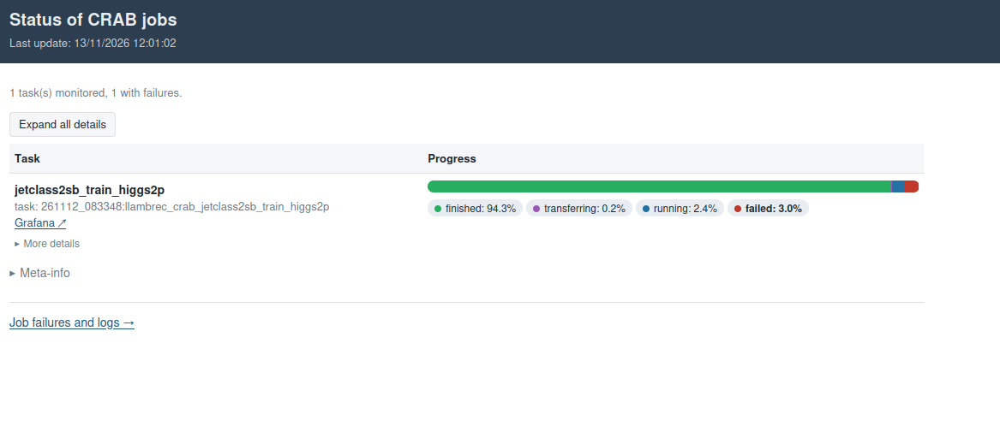
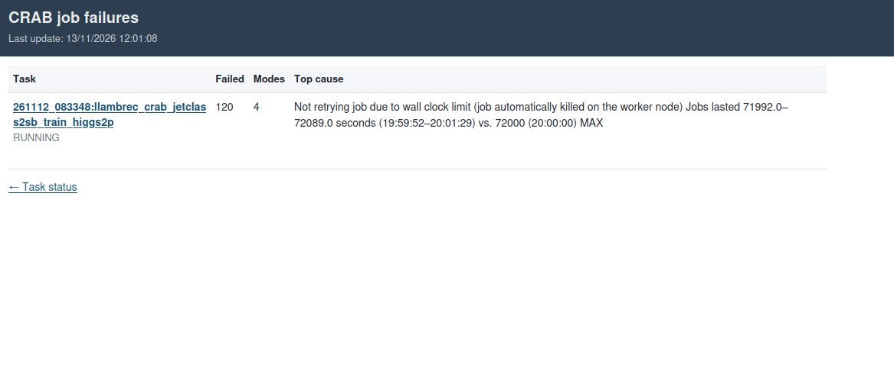
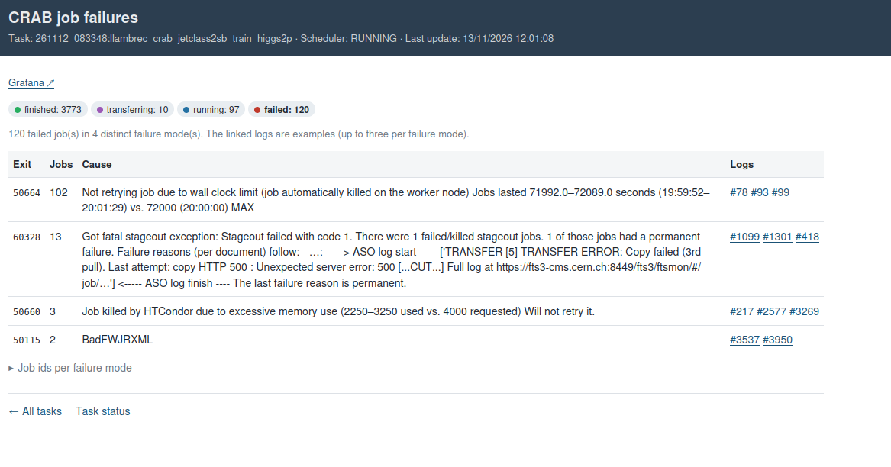

# CRAB job monitoring

This is a simple tool for quick and easy monitoring of a large number of CRAB jobs.
It is essentially just a wrapper around the `crab status` command, but structures the results into an easy-to-navigate overview like this one:



### Prerequisites

- **Packages:** The `crabmon` package itself is lightweight and has few dependencies. It needs `bash` and `python` with a few basic packages (todo: make detailed list).
- **Environment:** `crabmon` needs to run from an environment with access to your CRAB working directories. So far, it has been tested on `lxplus` only. 
- **[Optional] web hosting:** `crabmon` produces the status overview page in the form of a bunch of html files, which you can open using any web browser.
However, to view them from multiple devices (e.g. check from your phone once in a while) without having to copy over the html files, you can host them somewhere on the web.
This is easy if you're working on `lxplus`, just follow [these instructions](https://webeos.docs.cern.ch/).
After having gone through those steps, it's as simple as copying the folder with html files to a specified location on `/eos` (can be done automatically after each run).

### What it does

This tool serves as an intermediate layer and link between raw `crab status` commands and detailed Grafana dashboards.
It runs `crab status` on all specified CRAB working directories, collects the results, and parses them in a clear overview page.
This page also contains more detailed information on failed jobs, as well as links to the Grafana dashboards and full logs for all the details.

The main status page looks like this (with only one CRAB task in this example):


Clicking `Job failures and logs` takes you to an overview page of the failed jobs within each task:


You can click each individual task to see more details, such as these:


Finally, for the full details, you can check the linked Grafana dashboard and full logs.

### How to run

The basic command is `python3 crabmon.py <options>`.
Run `python3 crabmon.py -h` to see a list of all supported options and their meaning.
The basic ones are these:
- `-i` / `--searchdir`: top-level directory that will be searched recursively for CRAB project directories.
- `-t` / `--requestdir`: one or multiple CRAB project directories. Use this as an alternative to `-i`, if you only want to run on a subset of CRAB project directories.
- `-d` / `--webdir`: directory to write the output html pages to.

An example would be:
```
python3 crabmon.py -i /eos/user/l/llambrec/projectX/crab/production_logs/ -d /eos/user/l/llambrec/www/crab_jobs_monitor
```
This assumes the `production_logs` folder contains the crab working directories (meaning the `crab_<requestName>` folders created by CRAB).
The output will be put in the specified directory. You can read the html pages locally using any web browser, or, if `eos` hosting is set up correctly, see them online.

### Automatic updates using crontab

To avoid having to run this command manually every time you want to check the status, you can add it to the crontab.
For this purpose, there is a wrapper `crabmon.sh` that sets up the environment and allows you to set some default values.
You can install a crontab on lxplus using `acrontab -e`.
Add something like the following example:
```
0,15,30,45 * * * * lxplus.cern.ch cd /eos/home-l/llambrec/crabmon; bash monitor_crab_jobs.sh -i <input path> -p <path to your proxy> -d <path to destination> >> monitor.log 2>&1
```
This will run `crabmon` every 15 minutes and put the summary in the specified destination (overwriting the previous version).
